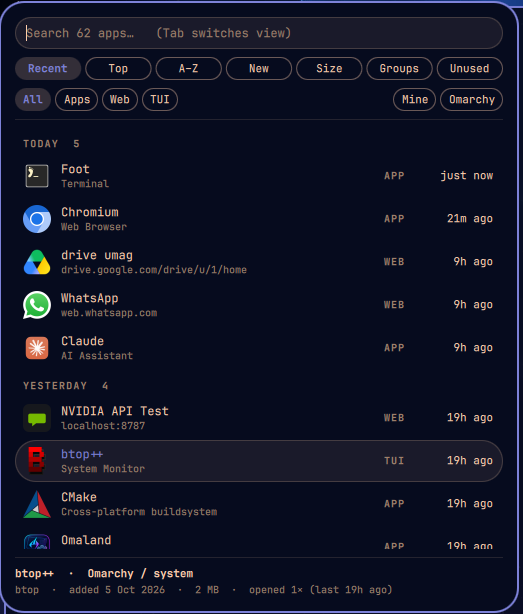

# omapantry



A tiny start menu for the Omarchy bar. Click the apps icon (right after the Omarchy menu) to browse everything launchable: native apps, webapps and TUIs.

**Views** (Tab / Shift+Tab, or ←/→ when the search box is empty): Recent · Top (most opened) · A–Z · New (install date) · Size · Groups (category) · Unused.
**Filters:** All / Apps / Web / TUI, plus **Mine** (installed by you, your webapps, custom launchers) vs **Omarchy** (shipped with Omarchy or pulled in as dependencies).
**Search** is always live and overrides the view. ↑/↓ move, Enter launches, Esc clears the search and then closes.

**Editing:** right-click a row (or press Ctrl+E) on one of *your own* launchers (webapps, custom launchers in `~/.local/share/applications`) to rename it or, for webapps, change its URL. System apps and symlinked launchers are never editable. The URL must be `http(s)://` with no spaces or quotes.

Colors, borders, fonts and corner radius all come from the shell's theme tokens, so it follows `omarchy theme set`.

## Install

```bash
omarchy plugin add https://github.com/heelgueta/omapantry.git --enable
```

Or review it first: `omarchy plugin add <url>` clones it disabled, then `omarchy plugin enable heelgueta.omapantry`.
Update with `omarchy plugin update heelgueta.omapantry`; remove with `omarchy plugin remove heelgueta.omapantry`. Optional keybinding: `omarchy-shell heelgueta.omapantry toggle`.

## Requirements

Omarchy with Hyprland, Python 3 (standard library only), and tools Omarchy already ships: `pacman`
(read-only queries), `gtk-launch`, `setsid`, `xdg-terminal-exec`, `omarchy-launch-webapp`.
No sudo, no install hooks, no network access.

## Privacy

Everything stays on your machine. The tracker only records which app launched and when
(`~/.local/share/omapantry/usage.jsonl`); nothing is sent anywhere. `./uninstall.sh --purge` deletes it.
The only file outside its own data that omapantry ever writes is a launcher you explicitly edit,
and only after saving the original to `~/.local/share/omapantry/backups/` (restore by copying it back).

## How it works

- `backend/omapantry.py index` scans the desktop entries and asks pacman for owner, install date, size and install reason. A package listed in Omarchy's own package lists, or installed as a dependency, counts as "Omarchy". Webapps are detected from `omarchy-launch-webapp` / `--app=`. A launcher whose Exec is a small script of yours ending in `omarchy-launch-webapp <url>` (or `"$URL"` set earlier in the script) is tracked as that webapp too.
- `backend/omapantry.py track` runs as a child of the shell, listens to Hyprland's `openwindow` events and appends `{t, id}` to `~/.local/share/omapantry/usage.jsonl`. This is how Recent and Top work for apps started from anywhere. Launching from the menu logs too, with de-duplication. History starts when you install; Linux keeps no earlier record. TUIs that share a window class (`TUI.float`/`TUI.tile`) are told apart by the command running in them when the terminal exposes it; otherwise they are only counted when launched from omapantry.
- **Native windows** are matched by window class, then confirmed by the process behind the window (its command line from `/proc`). That is what tells apart apps that share a class: a GUI and its TUI launcher both using `varwiz`, or several TUIs sharing `TUI.float`. A terminal-hosted TUI is matched by its `--app-id`.
- **Webapp windows** are matched by the class Chromium gives them (`<browser>-<host>_<path>-<profile>`, port and `#fragment` dropped), so webapps on the same host, such as two Gmail accounts or two Drive folders, are told apart by path. Chromium gives an identical class to every `localhost` webapp and all browser app windows share one pid, so those are resolved by a menu launch in the last 30 s, then by the window title. If that can't decide, nothing is logged rather than guessing.
- The launcher list is re-read whenever `~/.local/share/applications` changes, so a webapp you just created is tracked immediately.
- `backend/omapantry.py edit <id> <name> [url]` backs the editor: it only touches plain files in `~/.local/share/applications`, validates the URL, saves the original first, and replaces the file atomically.
- `Panel.qml` renders it.

## Install from a checkout / undo

```
./install.sh               # symlink into ~/.config/omarchy/plugins and add to the bar
./install.sh --no-enable   # symlink only
./uninstall.sh             # remove from bar, unlink, stop tracker (keeps usage history)
./uninstall.sh --purge     # also delete ~/.local/share/omapantry and ~/.cache/omapantry
```

`install.sh` saves `~/.config/omarchy/shell.json.pre-omapantry` the first time it runs. Optional keybinding: `omarchy-shell heelgueta.omapantry toggle`.
